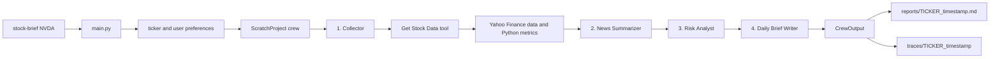

# CrewAI Stock Analysis

A small CrewAI project that turns public market data into an evidence-aware daily stock brief. It is designed as a learning project: Python gathers and calculates the data, while the crew explains what it means in clear language.

## Setup

Use Python 3.10 through 3.13.

Create and activate a virtual environment, then install the project with its development dependencies:

```powershell
python -m venv .venv
.\.venv\Scripts\Activate.ps1
python -m pip install --upgrade pip
python -m pip install -e ".[dev]"
```

Copy `.env.example` to `.env` and set the credentials required by your selected CrewAI-supported model provider. For MiniMax, set `MINIMAX_API_KEY` and use a LiteLLM model name such as `minimax/MiniMax-M3` for `OPENAI_MODEL_NAME`. The key is sent in the provider's `Authorization` header.

Optionally copy `knowledge/user_preference.example.txt` to
`knowledge/user_preference.txt` and customize it locally. Without that file,
the project uses generic beginner-friendly preferences. Preferences are sent
to the configured model provider; never put credentials, account identifiers,
or other private information in them.

## Run a report

```powershell
stock-brief NVDA
stock-brief SNDK
```

The final brief is printed to the terminal and saved as a timestamped Markdown file under `reports/`.

## Learn From A Run

This project uses CrewAI's classic Python and YAML layout. Run it with the
default full trace to see CrewAI's live agent/tool messages and save a local
record of the run:

```powershell
stock-brief NVDA --trace full
```

The final brief stays on standard output. Learning logs are written to standard
error and to a timestamped folder under `traces/`. Trace files are intended
for local use and can include preferences, market data, prompts, and model
responses. The supplied ignore rules exclude them, but files already tracked
by Git require a separate index and history review.



The crew uses `Process.sequential`, so tasks run in the order shown. In this
mode, CrewAI gives each later task the outputs from earlier tasks as context.
The collector is the only agent with the `Get Stock Data` tool. That tool calls
Yahoo Finance and calculates repeatable metrics in Python; the other agents
interpret only the information handed to them.

### Trace Modes

| Command option | What you see | Files saved |
| --- | --- | --- |
| `--trace full` | CrewAI's complete verbose agent and tool activity, plus application lifecycle logs | `learning.log`, `crewai-events.json`, task outputs, and `run-summary.json` |
| `--trace summary` | Application lifecycle and Yahoo Finance retrieval logs | `learning.log`, task outputs, and `run-summary.json` |
| `--trace off` | Only the final report or an error | No trace files |

Use `--trace-dir path/to/folder` to place artifacts elsewhere. Keep a custom
trace directory outside the repository, or explicitly ignore it and verify
the exclusion before staging. Each trace folder
contains `task-outputs/01-...md` through `04-...md`, in execution order. Read
them side by side to see what the next agent received and how it transformed
that context. `run-summary.json` records metadata, duration, token usage
when the provider returns it, and the final report location, which may be an
absolute local path. Both summary and full modes retain raw task outputs;
neither mode sanitizes files for public sharing.

Full trace mode can be noisy and may include prompts or model output. Do not
share its files publicly without reviewing them, and never place API keys in
agent/task YAML files or the preference file.

### Where To Learn In The Code

- `src/scratch_project/config/agents.yaml`: each agent's role, goal, and
	backstory. These guide how an agent approaches its task.
- `src/scratch_project/config/tasks.yaml`: each assignment, expected output,
	assigned agent, and the `{ticker}` / `{user_preferences}` placeholders.
- `src/scratch_project/crew.py`: the decorators that load YAML definitions and
	assemble agents and tasks into a sequential `Crew`.
- `src/scratch_project/tools/custom_tool.py`: the Python function exposed to an
	agent as the `Get Stock Data` tool.
- `src/scratch_project/main.py`: CLI parsing, input preparation, `kickoff()`,
	report persistence, and trace artifacts.

Try one change per run, then compare the matching task-output files:

1. Change the collector's goal and observe whether it still calls the tool as
	 instructed by `collect_task`.
2. Change the summarizer's requested bullet count and inspect its task output.
3. Change `knowledge/user_preference.txt` and compare only the final writer
	 output.
4. Run once with `--trace summary` and once with `--trace full` to separate
	 application logs from CrewAI's internal execution stream.

## What the report uses

- Latest available close, daily change, and five-session return
- 20-day and 50-day simple moving averages, plus 14-period RSI
- Recent volume relative to its 20-session average
- Available market capitalization, trailing P/E, and 52-week range
- Recent headlines with sources and links when provided by Yahoo Finance
- Company industry/sector classification and industry-related headlines,
  when the Yahoo Finance search API provides usable results

### Industry News And Sentiment

The tool makes one best-effort `yfinance.Search` request using the company's
industry name. It requests up to ten results with a ten-second timeout and
returns at most eight unique headlines. It does not retrieve article bodies
or require another API key. Missing classification, unsupported search,
request failures, or sparse results do not remove the collected stock metrics.

The report includes **Industry news and sentiment**. Existing agents assess
the relevant news as positive, negative, neutral, mixed, or insufficient
evidence. Any assessment other than insufficient evidence requires at least
two unique, source-linked, dated industry-relevant stories from the preceding
seven days in UTC. Company-news duplicates, company-only stories, unrelated
results, stale or future-dated stories, and undated articles cannot support
the assessment. Undated articles may be shown with an explicit warning.

This is AI interpretation of a selective industry-related news sample, not a
yfinance-provided sentiment score or measured sentiment across the entire
industry. Search relevance and coverage vary. Missing evidence is reported
explicitly rather than described as neutral. All original report sections
and the educational disclaimer remain.

`yfinance` is a best-effort public-data source. Data may be delayed, incomplete, or unavailable. Reports are educational summaries, not financial advice or trading recommendations.

## Project structure

- `src/scratch_project/tools/custom_tool.py`: data collection and deterministic calculations
- `src/scratch_project/config/`: CrewAI agent and task instructions
- `src/scratch_project/crew.py`: four-agent sequential crew composition
- `src/scratch_project/main.py`: command-line entry point and Markdown persistence
- `knowledge/user_preference.txt`: preferences passed to the brief writer
- `tests/`: offline tests that mock external services

## Tests And Packages

```powershell
python -m pytest
python -m pip install build
python -m build
python scripts/check_publication.py --archives dist
```

Tests use fake market/model responses and temporary paths, not your actual
credentials or preferences. The archive check verifies that required agent/task
YAML files are included and private paths are absent. GitHub Actions tests
Python 3.10-3.13 on Linux and Python 3.12 on Windows, checks installed-wheel
resources and CLI help, and scans publication paths and secrets. CI does not
run stock analyses, receive provider credentials, or upload reports/traces.

## Publish To GitHub Safely

The supplied ignore rules exclude local environment variants, private knowledge,
reports, traces, logs, credential containers, caches, and backups. Only the
reviewed `.env.example` and generic preference example should be published.
Ignore rules do not remove tracked files or history, and `git add -f` bypasses
them. The publication checker rejects private and unreviewed indexed paths;
its allowlist must be reviewed when intentionally adding a new public root.

1. Keep this project in its own repository. If it is not a Git repository yet,
	initialize one locally only when ready; no repository or remote is created
	by the application.
2. Review public source/configuration files and examples before staging. Do
	not include private data in source comments, examples, screenshots, issue
	reports, commit messages, or copied outputs. Console output is not redacted.
3. Stage the reviewed files, then check the candidate index:

	```powershell
	git diff --cached --name-status
	python scripts/check_publication.py
	```

4. Install the official Gitleaks CLI (CI pins version 8.30.1 and verifies its
	release checksum). Export the staged contents outside the repository and
	scan them before committing or pushing:

	```powershell
	$snapshot = Join-Path ([System.IO.Path]::GetTempPath()) ([guid]::NewGuid().ToString())
	python scripts/check_publication.py --staged-snapshot $snapshot
	gitleaks dir --redact --no-banner $snapshot
	```

	The export uses the index, not potentially different working-tree contents.
	Without a Git repository, `--snapshot` can export a source-review candidate,
	but that does not verify what will eventually be staged or committed.

5. After making reviewed local commits, scan all reachable history before the
	first push, and repeat before later pushes:

	```powershell
	gitleaks git --redact --no-banner --log-opts="--all" .
	```

6. If private files or credentials were committed, do not push. Remove private
	files from the index without deleting your local copies, rotate exposed
	credentials where applicable, and plan history cleanup separately. Review
	branches, tags, commit messages, and any prior publication too.
7. Enable GitHub secret scanning and push protection where available. CI is
	a secondary check after upload, not a substitute for the local pre-push
	checks. Do not add provider secrets, scheduled analysis jobs, or trace/report
	uploads to this test-only workflow.

No scanner can guarantee detection of every secret or personal detail. Review
the exact publication contents before choosing repository visibility. Keep
review snapshots private and remove them when no longer needed. No license is
selected automatically; choose one explicitly before granting reuse rights.
